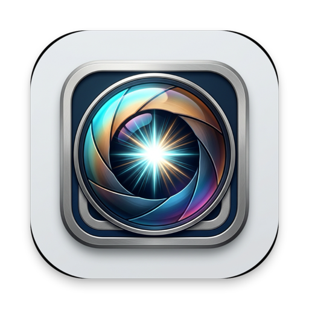

<div align="center">



# 📸 Glance for macOS ⚡

### The ultra-fast, native macOS photo viewer & pro culling tool 🚀  
*Instant full-screen folder browsing, zero-latency keyboard navigation, and pro RAW culling.*

[](https://github.com/mortalezz/glance/releases/latest)
[](https://github.com/mortalezz/glance)
[](https://github.com/mortalezz/glance)
[](https://github.com/mortalezz/glance)
[](https://github.com/mortalezz/glance)
[](https://github.com/mortalezz/glance)
[](LICENSE)

</div>

---

> [!NOTE]
> ### 🕊️ The Premise of Glance: Passing the Torch from Phoenix Slides
>
> For years, one utility reigned supreme on the Mac for quick folder inspection: **Phoenix Slides**. It solved a deceptively simple problem better than anything else before or since:
>
> 🎯 **Open any picture from a folder straight into a full-screen view, and immediately fly through the entire directory with pure keyboard navigation.**
>
> While Phoenix Slides still receives occasional maintenance patches to stay alive on modern macOS, its legacy architecture and dated UI show their age on Apple Silicon—especially when confronted with modern high-resolution sensors and RAW workflows. Meanwhile, newer image viewers have drifted to the opposite extreme: bloated web-wrapped apps or heavy catalog managers that demand importing photos into proprietary databases before you can even look at them.
>
> **Glance** was born directly out of that gap—taking the instant, zero-friction philosophy of Phoenix Slides and rebuilding it from the ground up for modern macOS and pro photography workflows:
>
> 1. 🖼️ **Finder-Direct Full Screen:** Open any photo directly from Finder straight into an edge-to-edge viewport.
> 2. ⚡ **Zero-Latency Traversal:** Fly through the entire folder with arrow keys or `Space`—zero lag, zero spinners, zero waiting.
> 3. 🫧 **Native macOS Vibrancy:** Clean, distraction-free viewing with frosted-glass HUD overlays that vanish when you don't need them.
>
> From this foundation, Glance adds modern pro culling superpowers: **1:1 pixel peeping**, **2-up burst compare**, **Adobe XMP sidecar sync**, **hardware-accelerated histograms**, and **exposure blinkies**.

> [!TIP]
> 💡 **Community Testing & Feedback Welcome!**  
> Glance is open-source and actively evolving. Feedback, feature requests, and testing on real-world photo shoots from photographers and Mac enthusiasts are always warmly welcomed!

---

## ⚡ Proud Features

| Feature | Highlight |
| :--- | :--- |
| 🚀 **Zero-Latency Keyboard Navigation** | Speculative triple-buffering and asynchronous background lookahead decode make folder traversal instantaneous on 45MP+ RAW and high-resolution JPEG files. |
| 🫧 **Unified Semantic Glass Theming (`T` / `D`)** | Complete frosted-glass system adhering strictly to Apple HIG for both Dark and Light modes. Optical translucency provides depth and bleed-through without sacrificing contrast or legibility. |
| 🔍 **Spring-Loaded 100% Loupe (`Hold Z` / Click)** | Hold `Z` to instantly pop into 1:1 sensor loupe and glide mouse/trackpad to pan without clicking; release `Z` to snap back to grid. Tap `Z` toggles. In 4-UP, hovered frame expands solo edge-to-edge 100% loupe. |
| 🔬 **Machined Optical Reticle Loupe (`M`)** | Floating circular magnifier with engraved lens barrel bezel ticks, optical vignette, and viewfinder reticle. Press `M` or click to cycle 2× ➔ 4× ➔ Off with mouse-following tracking and system cursor auto-hide. |
| 👁️ **Face & Eye Focus Inspection Dock (`A`)** | Narrative face crop strip with AI focus sharpness scores. ON by default; intelligently auto-hides when 0 faces are in frame. |
| ⚡ **Scene Leap Navigation (`]` / `[` or `⌘➔` / `⌘⬅`)** | Skip across bursts directly to scene boundaries using local Apple Neural Engine visual embeddings and timestamp deltas. |
| 👑 **Hero of the Burst (`B` Key & 👑 Badges)** | Local Vision AI quality scoring automatically crowns the best shot in every burst cluster. Press `B` to leap directly to the 👑 Hero frame. |
| ⚡ **Burst Knockout (`⇧P`)** | Flag the active photo as the winning keeper while automatically marking all other burst siblings as rejected in a single stroke. |
| ⊞ **Modal Multi-Up Matrix (`S` / `Tab`)** | Cycle 1-UP ➔ 2-UP ➔ 4-UP Floating Studio Tiles with continuous 10px squircles, 6px gutters, deep charcoal canvas, semantic glowing rims (Teal, Amber, Purple, Emerald), and quadrant haptics. |
| 🫧 **Top-Down Dynamic Toast System** | Decouples transient event feedback (Leaps, Undos, Toggles) from the bottom HUD into an Apple-style floating top banner, keeping bottom telemetry rock-solid with zero jitter. |
| 🎛️ **Tactile Trackpad Haptics** | Subtle physical clicks via `NSHapticFeedbackManager` whenever ratings (`1`–`5`), picks (`P`), rejects (`X`), quadrant hovers, or burst leaps occur. |
| ↩️ **Multi-Level Undo & Redo (`Cmd + Z` / `Cmd + Shift + Z`)** | 100-step in-memory undo/redo stack for star ratings, color tags, picks, burst knockouts, lossless rotations, and physical trash recovery. |
| 🎨 **External App Handoff (`Cmd + Enter` / `Cmd + O`)** | One-key handoff to immediately launch the active RAW/photo in your default editor (Lightroom, Photoshop, Capture One, Preview). |
| 🏷️ **Adobe XMP Sidecar Synchronization** | Real-time, non-destructive rating (`★`), color tagging, and flag management fully compatible with **Adobe Lightroom Classic, Capture One, Darktable, and Photo Mechanic**. |
| 🗂️ **RAW + JPEG Sibling Stacking** | Automatically pairs camera RAWs (`.ARW`, `.CR2`, `.CR3`, `.NEF`, `.RAF`, `.DNG`, etc.) with companion JPEGs, browsing the fast preview and inspecting master RAW sensor data during zoom. |
| ⚡ **Sub-5ms Embedded RAW Decoding** | Standalone RAW files extract the camera’s high-resolution embedded preview during folder scrubbing, deferring full sensor demosaicing until 1:1 zoom. |
| 🛡️ **Silent FSEvents Directory Sync** | Monitors folder for new photos with `kFSEventStreamCreateFlagIgnoreSelf` and path filters, completely ignoring Glance’s own XMP writes to eliminate cache thrashing. |
| 📊 **Hardware RGB & Luminance Histogram (`H`)** | 256-bin SIMD/vImage hardware-accelerated histogram rendered inside an Apple Vibrancy frosted-glass HUD with shadow and highlight clipping indicators. |
| 🌈 **ARRI False Color Exposure HUD (`⇧O`)** | Cine-standard 7-band exposure visualization with IRE scale legend (Clip 100%, Roll-off 98%, High 80%, Skin 54%, 18% Gray 40%, Shadow 3%, Crush 0%). |
| 🚨 **Exposure Clipping Warnings / "Blinkies" (`O`)** | Animated pulsating zebra overlays for overexposed blown highlights (Red) and underexposed crushed shadows (Blue). |
| 🎯 **Real-Time Focus Peaking Overlay (`Shift + F`)** | Camera EVF-style neon green (#00FF50) edge highlight powered by Accelerate.vImage directional Sobel spatial gradient convolution to instantly verify critical plane of focus. |
| 🎞️ **Camera Profiles & Film Simulations (`V`)** | Hardware-accelerated picture controls with brand intelligence: **Fujifilm Film Simulations** (Velvia, Provia, Astia, Classic Chrome, Acros, Classic Neg) on `.RAF` and **Nikon Picture Controls** (Standard, Vivid, Neutral, Landscape, Monochrome) on `.NEF` with Adobe XMP sync. |
| 📷 **Expanded Technical EXIF Dossier (`I`)** | Displays lens, body, exposure parameters, 35mm crop factor, metering mode, white balance, shutter count, sensor MP, and serial numbers. Unfolds smoothly on hover with click-to-copy. |
| 🔄 **Lossless EXIF Rotation (`R` / `L`)** | `R` rotates 90° CW, `L` rotates 90° CCW for JPEGs, HEICs, and RAW XMP sidecars without re-compressing pixels. |
| 📦 **Batch Export Selects (`⇧E`)** | One-key export of all flagged `✓` Picks directly to `./Selects` directory with sound confirmation and Finder reveal. |
| 📽️ **Hands-Free Slideshow (`Return`)** | Full-screen automated slideshow with live `+` / `-` speed stepping (1s to 30s) and instant pause on any interaction. |
| 🪶 **Zero Bloat, Zero Electron** | Pure native Swift & AppKit, compiling down to a lightweight standalone binary without web runtimes. |

---

## ⌨️ Complete Keyboard Shortcuts Cheatsheet

Press **`?`** (`Shift + /`) at any time inside Glance to toggle the interactive frosted-glass shortcuts cheatsheet.

### 🏷️ Culling & Rating
| Key | Action | Description |
| :---: | :--- | :--- |
| **`P`** | **Pick / Flag 🟢** | Mark photo as a keeper with vibrant green badge |
| **`⇧P`** | **Burst Knockout 👑** | Pick current best frame, auto-reject all burst siblings |
| **`X`** | **Reject 🔴** | Mark photo as a reject for deletion (`xmp:Rating=-1`) |
| **`U`** | **Unflag ⚪** | Clear pick / reject status to neutral in Adobe XMP |
| **`1` – `5`** | **Star Rating ⭐** | Rates image `★` to `★★★★★` (vibrant gold) |
| **`0`** | **Clear Rating ✖️** | Clears star rating |
| **`6` – `9`** | **Color Labels 🎨** | `6`: Red 🟥 &nbsp; `7`: Yellow 🟨 &nbsp; `8`: Green 🟩 &nbsp; `9`: Blue 🟦 |
| **`C`** | **Auto-Advance ⚡** | Speed culling: automatically advances after rating/tagging (ON by default) |
| **`\`** | **Cycle Filters 🔀** | Cycles populated filters (skips unassigned stars/flags) |
| **`⇧\`** | **Picks Only Review ✓** | Quick toggle between Picks Only and All Files |

### 🔍 Review, Focus & Comparison
| Key | Action | Description |
| :---: | :--- | :--- |
| **`Hold Z`** / **`Z`** | **Spring-Loaded 100% Loupe 🔍** | Hold `Z` to zoom & glide pan; release to snap back. Tap `Z` toggles |
| **`Shift + Z`** / **`2×Z`** | **Auto Face & Eye Jump 👁️** | Centers 1:1 zoom directly on subject's eye; press again to cycle faces |
| **`M`** | **Optical Reticle Loupe 🔬** | Floating 2× / 4× circular reticle loupe (cycle with `M` or click) |
| **`A`** | **Face Inspection Dock 👤** | Narrative face crop strip with AI sharpness scores (auto-hides if 0 faces) |
| **`[` / `]`** / **`⌘Arrows`** | **Scene Leap Navigation ⚡** | Leap across burst sequences straight to scene boundaries |
| **`B`** | **Burst Hero Leap 👑** | Leap directly to the 👑 Hero / Best-in-Burst keeper frame |
| **`S`** / **`Tab`** | **Multi-Up Compare Matrix ⊞** | Cycles 1-UP ➔ 2-UP ➔ 4-UP Floating Studio Tiles with quadrant haptics & glowing rims |
| **`Shift + F`** | **Focus Peaking Overlay 🎯** | Real-time camera EVF neon green highlight on in-focus contrast edges |

### 📊 Exposure & Information Overlays
| Key | Action | Description |
| :---: | :--- | :--- |
| **`H`** | **RGB Histogram 📊** | Live 256-bin RGB & Rec. 709 Luminance histogram HUD |
| **`O`** | **Exposure Clipping 🚨** | Pulsing highlight (Red) and shadow (Blue) "blinkies" |
| **`⇧O`** | **ARRI False Color 🌈** | 7-band exposure visualization HUD with IRE scale legend |
| **`I`** | **EXIF Technical Dossier 📷** | Camera, lens, exposure, 35mm crop, shutter count, sensor MP. Hover to unfold; click to copy |
| **`V`** | **Camera Profile / Film Sim 🎞️** | Cycle brand-aware profiles (Fujifilm Velvia/Classic Chrome, Nikon Vivid, etc.) |
| **`T`** / **`D`** | **Theme Toggle 🌓** | Switch between Frosted Dark & Frosted Light glass themes |
| **`?`** | **Cheatsheet 💡** | Toggle shortcuts cheatsheet (Space expands full guide) |

### 🛠️ Workflow & Output
| Key | Action | Description |
| :---: | :--- | :--- |
| **`R`** | **Rotate CW ↷** | Lossless 90° clockwise rotation via EXIF |
| **`L`** | **Rotate CCW ↶** | Lossless 90° counter-clockwise rotation via EXIF |
| **`E`** | **Quick Export 📦** | Copies current active photo to `./Selects` folder |
| **`⇧E`** | **Batch Export Selects 🚀** | Batch-exports all flagged `✓` Picks and sidecars to `./Selects` |
| **`Return`** | **Slideshow 📽️** | Start/stop automated hands-free slideshow |
| **`+`** / **`-`** | **Slideshow Speed ⏱️** | Increase / decrease slideshow interval at set steps (1s – 30s) |
| **`Cmd + Z`** | **Undo ↩️** | Reverts ratings, flags, colors, rotations, or restores trashed photos |
| **`Cmd + Shift + Z`** | **Redo ↪️** | Re-applies reverted culling actions |
| **`Cmd + Enter`** / **`Cmd + O`** | **Open in Editor 🎨** | Launches active RAW/photo in default macOS editor (Lightroom, Photoshop, etc.) |
| **`Delete`** / **`Backspace`** | **Trash 🗑️** | Move active file (and its RAW / XMP pair) to macOS Trash |
| **`Shift + Delete`** | **Purge Rejects 💥** | Safely batch moves all rejected (`X`) images to macOS Trash |

### 🧭 Navigation
| Key | Action |
| :---: | :--- |
| **`→`**, **`Space`**, **`↓`**, **`N`** | Next image ⏩ |
| **`←`**, **`↑`**, **`Page Up`**, **`K`** | Previous image ⏪ |
| **`Home`** / **`End`** | First / Last image in folder 🏁 |
| **`F`** | Toggle Full Screen ⛶ |
| **`Esc`**, **`Q`** | Close / Exit ✕ |

---

## 🚀 Download & Installation

### Option 1: Install via Homebrew 🍺 (Recommended)
```bash
brew install --cask mortalezz/tap/glance
```

*Or tap the repository first:*
```bash
brew tap mortalezz/tap
brew install --cask glance
```

**To update to future releases:**
```bash
brew update
brew upgrade --cask glance
```

> **First Launch:** On first launch, if macOS displays an *"unverified developer"* notice (as Glance is distributed outside the Mac App Store), simply **Right-Click (Control-Click) `Glance.app` in `/Applications` ➔ Open** once, or run:
> ```bash
> xattr -cr /Applications/Glance.app
> ```

### Option 2: Direct Download 📦
Download the latest pre-compiled application bundle from the [**Releases Page**](https://github.com/mortalezz/glance/releases/latest):
1. Download **`Glance-v1.3.0-macOS.zip`**.
2. Unzip and drag `Glance.app` into your `/Applications` folder.
3. Right-click any image in Finder ➔ *Open With* ➔ *Glance* (or set Glance as your default image viewer for instant full-screen glory).

### Option 3: Build from Source 🛠️
```bash
# Clone the repository
git clone https://github.com/mortalezz/glance.git
cd glance

# Build and package the release application bundle
./scripts/build_app.sh

# Launch Glance with any folder or photo:
open Glance.app /path/to/folder
```

---

<div align="center">
<b>Glance</b> • Fast, native, beautiful macOS image viewing & culling.
</div>
