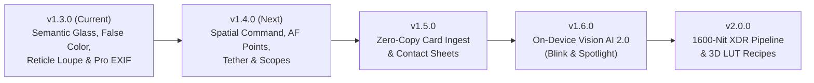

# 🗺️ Glance Roadmap: v1.4.0 & Beyond

> [!NOTE]
> **Architectural Philosophy**: Every milestone in Glance must preserve our core invariants: **0ms Finder-direct launch**, **zero proprietary databases**, **pure native Swift & AppKit**, and **100% adherence to the Unified Semantic Glass Theming Engine (`ThemedGlassCardView` & `ThemedPillView`)**.

---

## 🎯 Target Release: `v1.4.0` — Spatial Command, AF Verification & Live Tether

`v1.4.0` focuses on giving photographers spatial orientation across massive shoots, exact hardware autofocus verification, broadcast color scopes, and real-time studio tethering—all built atop the semantic frosted-glass design system.

### 1. 🎞️ On-Demand Floating Filmstrip Scrubber (`G` Key / Bottom-Edge Hover)
- **Problem**: In a 2,000+ photo wedding, sports, or commercial shoot, single-frame stepping or blind scene leaps aren't always enough—you want to visually scan a 30-frame window or scrub rapidly with the trackpad.
- **Design**:
  - Built on `ThemedGlassCardView(cornerRadius: 16)` docked just above the bottom telemetry HUD.
  - Hidden by default to preserve the clean edge-to-edge viewport; summoned on demand via **`G`** (or optional bottom-edge cursor hover).
- **Technical Specs**:
  - Asynchronous hardware-decoded micro-thumbnail ring buffer (zero main-thread hitching).
  - Visual burst grouping brackets connecting shots belonging to the same burst sequence, with a `👑` micro-badge on the burst Hero.
  - Live semantic overlays for Pick (`✓` green dot), Reject (`✕` dimmed), Star Ratings (`★`), and Adobe Color Labels.
  - Horizontal two-finger trackpad inertial scrolling and click-to-jump.

### 2. 🎯 Camera AF Point & Subject Box Overlay (`J` Key)
- **Problem**: Photographers need to verify *where the camera locked autofocus* versus where the lens achieved peak sharpness.
- **Design**:
  - Toggleable via **`J`** (with a semantic status pill in the HUD).
  - Renders crisp, double-contoured viewfinder AF brackets directly over the active photo (supports 1-UP, 2-UP, and 4-UP).
- **Technical Specs**:
  - MakerNote binary parser in `ExifMetadata` / `FocusPointEngine` extracting normalized `(x, y, width, height)` focus coordinates:
    - **Sony** (`FocusLocation` tag `0x2027`)
    - **Nikon** (`AFInfo2` phase-detect & subject-tracking box coordinates)
    - **Fujifilm** (`FocusPixel` tag `0x1023`)
    - **Canon** (`AFInfo` active AF area rectangles)
  - Color-coded semantic reticle: **Emerald** for confirmed in-focus lock, **Cyan** for Eye/Face tracking box, **Amber** for unconfirmed/manual focus point.

### 3. 🧭 Collapsible 1:1 Navigator Mini-Map (PiP)
- **Problem**: When pixel-peeping at 100% (`Z`) across a 45MP–60MP sensor, it is easy to lose spatial context within the composition.
- **Design**:
  - Appears automatically in the bottom-left corner when zoomed into `1:1` mode (collapsible via click).
  - Framed inside a compact `ThemedGlassCardView(cornerRadius: 10)` with a live high-contrast viewport bounding rectangle.
- **Technical Specs**:
  - Click or drag inside the mini-map to immediately pan the 1:1 sensor viewport to that region at 120Hz.

### 4. 📈 RGB Parade & Skin-Tone Vectorscope (`⇧H`)
- **Problem**: While the luminance/RGB overlaid histogram (`H`) shows overall tonal distribution, colorists and studio photographers rely on an **RGB Parade** to spot color casts in highlights/shadows and a **Vectorscope** to verify skin-tone hue accuracy.
- **Design**:
  - Pressing **`⇧H`** (or clicking the Histogram card) cycles the top-right scope card through:
    1. **Overlaid RGB + Luminance Histogram** (Default)
    2. **Side-by-Side R · G · B Waveform Parade**
    3. **2D Chrominance Vectorscope** with a calibrated **I-Line (Skin Tone Axis)**
- **Technical Specs**:
  - Computed via `Accelerate` / `vImage` on downsampled working buffers in <2ms and rendered inside `HistogramHudView` using semantic glass tokens.

### 5. 📡 Live Tethered Hot-Folder Follow Mode (`⌘T`)
- **Problem**: Studio photographers shooting tethered into Capture One, Lightroom, or camera utilities want a zero-distraction client/director monitor that automatically displays each new shot the instant it hits the disk.
- **Design**:
  - Toggle **Tether Follow Mode** via **`⌘T`** (displays a pulsing live indicator pill `[ • TETHER ]` in the HUD).
- **Technical Specs**:
  - Powered by Glance's existing `DirectoryWatcher` (`FSEvents`).
  - **1-UP Mode**: Automatically leaps to the newest incoming RAW/JPEG within 50ms of file completion.
  - **2-UP "Pin Hero" Mode**: Pin your favorite reference/select shot on the **Left Pane**, while every newly captured studio shot automatically populates the **Right Pane** for instant side-by-side lighting and expression comparison.

---

## 🔭 Future Horizons

### Horizon 2: `v1.5.0` — Zero-Copy Card Ingest & Client Delivery
- ⚡ **SD / CFexpress Zero-Copy Fast Ingest (`⌘I`)**: Browse and cull photos *directly off mounted camera cards* at 0ms while copying to primary + backup SSDs in the background with SHA-256 checksum verification and date/scene folder naming.
- 🖼️ **Glass Contact Sheet / Proof Exporter (`⌘P`)**: One-key generation of high-resolution Dark or Light themed contact sheet PDFs / 4K PNGs with filenames, star ratings, and shooting EXIF.
- 🏷️ **Batch IPTC & XMP Stamper (`⌘B`)**: Stamp Photographer, Copyright, Event Name, and preset XMP tags across all Picks in a single atomic operation.

### Horizon 3: `v1.6.0` — On-Device Apple Vision AI 2.0
- 😑 **Synchronized Blink & Group Harmony Badges**: Enhance the `A` Face Inspection Dock with `👁️ All Eyes Open` vs. `⚠️ Blink Detected` pills and rank group portraits by simultaneous open eyes and expressions.
- 🔎 **Zero-Index Spotlight Filter (`⌘F`)**: Instant frosted-glass search bar combining EXIF predicates (`f/1.4`, `ISO 3200`, `23mm`, `5★`) with on-the-fly Apple Vision scene classification and OCR (race bibs, jersey numbers, slate boards).
- 🧹 **Outtake & Motion-Blur Sweeper**: Automatically identify accidental shutter bumps, floor shots, or severe camera shake for 1-click batch rejection.

### Horizon 4: `v2.0.0` — 1600-Nit XDR Pipeline & Non-Destructive Look Recipes
- ☀️ **True EDR / 1600-Nit HDR RAW Headroom (`XDR` Pill)**: Render linear RAW sensor dynamic range on MacBook Pro Liquid Retina XDR displays with a live `±3 EV` exposure offset scrubber to inspect highlight recovery before opening an editor.
- 🎨 **`.cube` 3D LUT Preview & Parametric XMP Quick-Grade**: Preview custom `.cube` LUTs while culling and write non-destructive `crs:Exposure2012` / `crs:Temperature` / `crs:Tint` tags directly into `.xmp` sidecars for Lightroom & Camera Raw.
- 📐 **Aspect Ratio & Cinema Crop Mattes (`⇧G`)**: Non-destructive frosted glass crop overlays for `4:5`, `1:1`, `16:9`, `2.39:1` Anamorphic, and `65:24` XPan.
